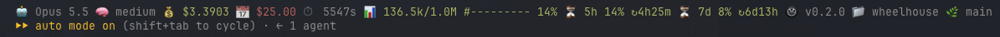

# Claude Code

Extras that only apply to Claude Code. What every tool supports, and the caveats per tool, is in [compatibility.md](compatibility.md).

## Show the wheelhouse version in the status line

A [status line](https://code.claude.com/docs/en/statusline) segment that shows which wheelhouse a session is using, e.g. `🛞 v0.3.1`, next to the folder name:



It looks in this order:

1. **The project's copy** (`--project`). The installer records the version in `.claude/skills/lead/.wheelhouse`. Copies made before v0.4.0 don't have it, so the segment shows the version of the source they were copied from, which may be newer.
2. **A global install** (symlinks): the `VERSION` that `get.sh` writes, or `plugin.json` in a git clone.
3. **The plugin**: its entry in `~/.claude/plugins/installed_plugins.json`.

It needs `jq`. Add the function to your status line script and append its output to what you print:

```bash
# wheelhouse version: project copy, then global install (symlinks), then the plugin
wheelhouse_version() {
  local dir=$1 marker root v
  if [ -f "$dir/.claude/skills/lead/.wheelhouse" ]; then
    marker=$(cat "$dir/.claude/skills/lead/.wheelhouse")
    v=$(grep -oE ' v[0-9][0-9.]*' <<< "$marker" | head -n 1 | tr -d ' ')
    [ -n "$v" ] && { echo "$v"; return; }
    root=${marker#* from }; root=${root%/skills/*}
  elif [ -L ~/.claude/skills/lead ]; then
    root=$(cd ~/.claude/skills/lead && pwd -P); root=${root%/skills/*}
  fi
  if [ -n "$root" ]; then
    [ -f "$root/VERSION" ] && { cat "$root/VERSION"; return; }
    v=$(jq -r '.version // empty' "$root/.claude-plugin/plugin.json" 2>/dev/null)
    [ -n "$v" ] && { echo "v$v"; return; }
  fi
  v=$(jq -r '.plugins["wheelhouse@wheelhouse"][0].version // empty' ~/.claude/plugins/installed_plugins.json 2>/dev/null)
  [ -n "$v" ] && echo "v$v"
}

input=$(cat)
wh=$(wheelhouse_version "$(jq -r '.workspace.project_dir // .cwd' <<< "$input")")
[ -n "$wh" ] && printf '🛞 %s' "$wh"
```

No status line yet? Save the snippet as `~/.claude/statusline.sh` and point `~/.claude/settings.json` at it:

```json
{
  "statusLine": { "type": "command", "command": "bash ~/.claude/statusline.sh" }
}
```

The segment is empty when no wheelhouse is installed for that project.
