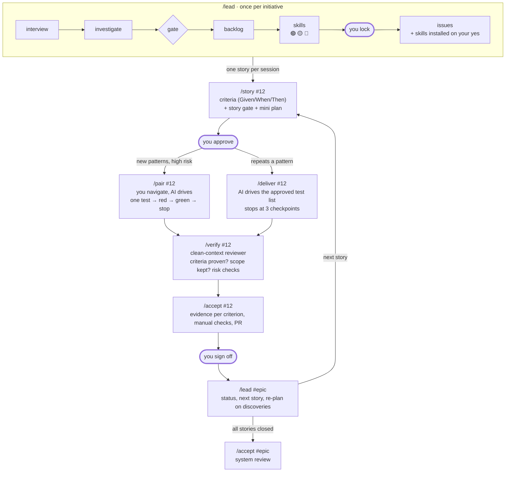
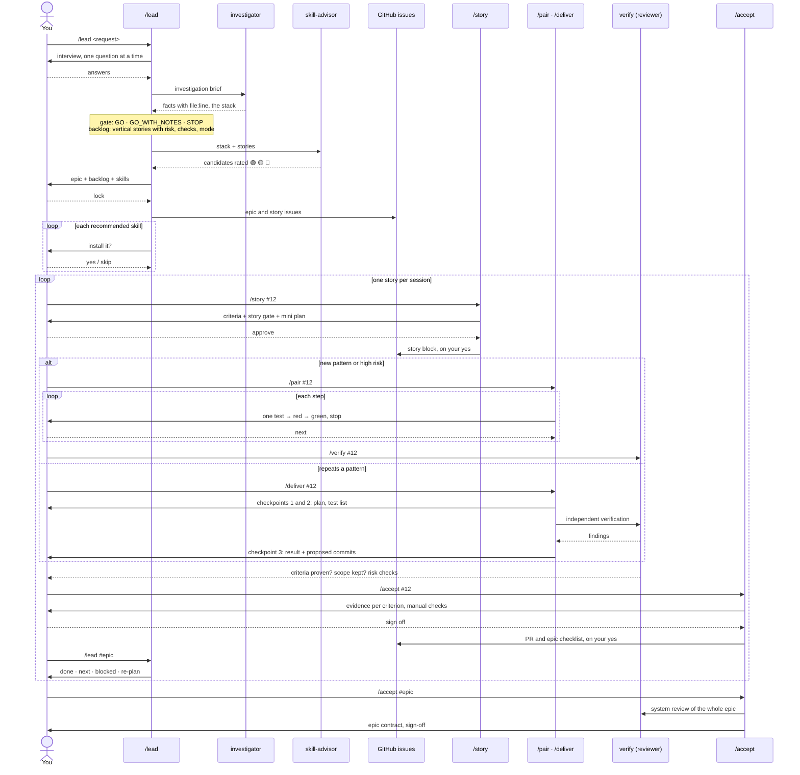

# The flow

wheelhouse splits building a feature into short phases, and each phase ends waiting for you. The AI does the engineering work in between: it investigates, plans, writes tests and code, and reviews. You make the product decisions and give every yes: locking the plan, approving a story's criteria, each step in pair mode, each skill installed, each commit and PR.

Two ideas shape it:

- **One story per session.** `/lead` plans once per initiative. After that, every story starts in a fresh session with `/story`, so each one begins from the tracker and the code instead of a long, drifting chat. That is also why installed skills only show up in the next session: the next session is where the work happens.
- **Whoever writes the change doesn't approve it.** `verify` reviews with a clean context, and `/accept` signs off only with evidence for every criterion.

The [README](../README.md#the-flow) has a plain-text version of this flow. Below are two diagrams of the same flow: the flowchart answers "what comes next?", and the sequence answers "who talks to whom, and when do I step in?".

## Flowchart

The steps in order. Thick borders mark the points where you decide.

- **`/lead`** runs once per initiative: it interviews you about what's unclear, investigates the repo with evidence, runs the feasibility `gate`, writes the backlog of vertical stories, and asks `skill-advisor` which third-party skills the work needs (rated 🟢 🟡 🔴). After you lock the plan, it writes the issues and installs only the skills you say yes to.
- **`/story`** refines one story right before it is built: 2–3 acceptance criteria, a story-level gate and a plan of at most five bullets.
- **`/pair` or `/deliver`** builds it test-first. Use `/pair` for a new pattern or anything high risk, `/deliver` when the story repeats a pattern you already set. The story's gate suggests one.
- **`/verify`** and **`/accept`** check the result independently, map each criterion to evidence and propose the PR.
- **`/lead #epic`** reports progress and re-plans when a story uncovered something. When every story is closed, `/accept #epic` reviews the epic as a whole.

## Sequence

The same flow as messages between you, the workflows, the subagents and the tracker.

Things the sequence shows that the flowchart doesn't:

- **The `investigator` subagent** does the code investigation for `/lead`, so the lead's context stays small. In a tool without subagents (Pi), `/lead` investigates inline.
- **Who starts the verification.** In `/pair` you run `/verify` yourself when the story is done. `/deliver` asks for the independent verification on its own, between its second and third checkpoints.
- **Writes to the tracker always wait for your yes**: the story block from `/story`, the PR and the epic checklist from `/accept`.
- **Commits**: `/pair` never commits; it suggests the message and you commit. `/deliver` proposes commits at checkpoint 3 and makes them only on your yes. Nothing pushes or merges unless you ask.

> In the sequence source, `#35;` is Mermaid's escape for `#`: in sequence diagrams an unescaped `#` cuts the rest of the message.
